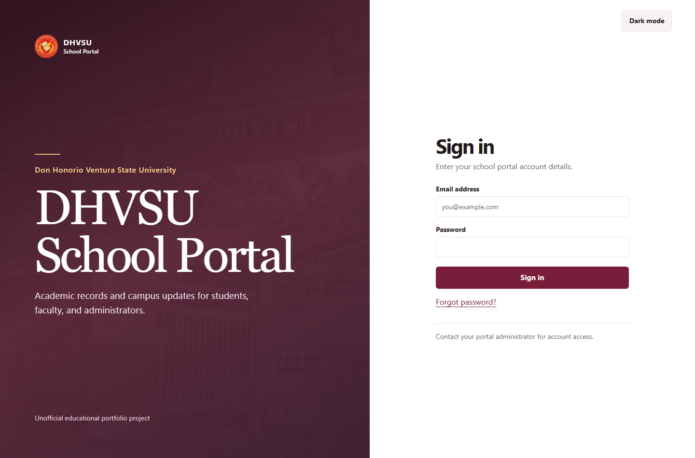
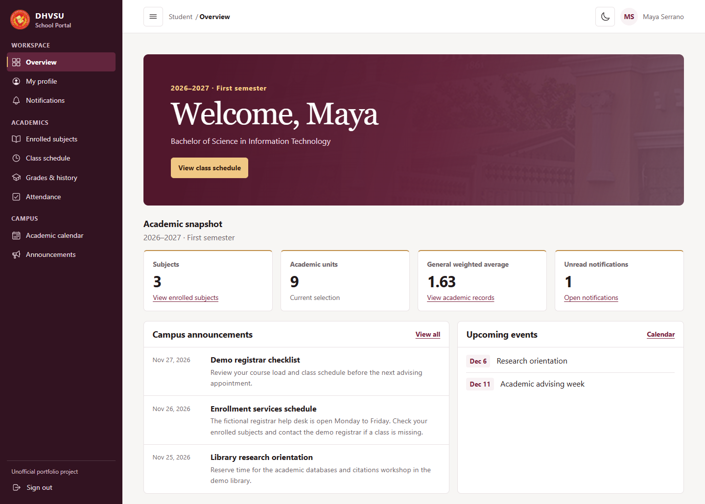

# DHVSU School Portal

An **unofficial educational portfolio project** by Christian Lao Bautista. The portal is a modernization of the original DHVSU-inspired student dashboard. It uses fictional academic records and has no affiliation with Don Honorio Ventura State University.

| Role | Workspace |
| --- | --- |
| Student | Profile, enrollment and subject load, weekly timetable, academic calendar, published grades and GWA, attendance, announcements, notifications, and a printable academic record |
| Faculty | Assigned classes and rosters, schedules, attendance, draft grades and submission for review, published class performance, and campus notices |
| Administrator | Account provisioning and activation, student and faculty directories, academic catalogs, faculty assignments, scheduling, enrollment, grade publication, announcements, calendar, audit log, and filtered CSV export |

## Architecture

Angular 21 and Ionic 8 provide the TypeScript SPA, with SCSS and FullCalendar for the interface. Supabase Auth issues sessions. The Angular client sends those sessions to the Supabase Data API, where PostgreSQL grants, row-level policies, and transaction constraints enforce access. The account provisioning Edge Function verifies the caller with Auth and checks their active administrator profile before calling the Auth Admin API. The browser bundle contains the public project URL and publishable key.

Cloudflare Pages serves the static build. The [database ERD](docs/erd.md) shows the academic and identity relationships. The [progress checklist](docs/progress.md) records the verification scope.

## Run a local demo

Use Node.js 22.12+ or 24 LTS, npm, the [Supabase CLI](https://supabase.com/docs/guides/local-development/cli/getting-started), Docker, and the PostgreSQL `psql` client on PATH.

```sh
npm ci
supabase start
supabase status
```

Copy `.env.example` to `.env`. Set `SUPABASE_URL` to `http://127.0.0.1:54321` and `SUPABASE_PUBLISHABLE_KEY` to the local publishable key from `supabase status`. The configurator also accepts a local legacy anon key. Set `LOCAL_SUPABASE_SERVICE_ROLE_KEY` to the local service-role key in your terminal environment or ignored `.env`. The build reads only the two browser variables.

```sh
npm run seed:demo
supabase functions serve portal-accounts --no-verify-jwt
```

In a second terminal, run `npm start` and open `http://localhost:4200`. Use the same origin throughout a password recovery flow. To rebuild a disposable local database from scratch, use `supabase db reset --local`, then run the demo seed again.

| Role | Local email |
| --- | --- |
| Student | `student@dhvsu-demo.example` |
| Faculty | `faculty@dhvsu-demo.example` |
| Administrator | `admin@dhvsu-demo.example` |

The local password is `Local-Demo!2026`. The seed creates two additional fictional identities to exercise scoped access. It anchors academic periods around the local database date and adds a past grade, active enrollments, timetable entries, attendance, announcements, and upcoming events. The seed script accepts loopback endpoints and is intended for a disposable demo stack. Give hosted demo identities distinct private passwords and reserve write-capable demo access for an isolated fictional dataset.

**Connected project demo.** The supplied Supabase project was provisioned with fictional data. On the implementation machine, the ignored `.env.hosted-demo` file holds the private passwords for the same role emails. Use `E2E_STUDENT_PASSWORD`, `E2E_FACULTY_PASSWORD`, or `E2E_ADMIN_PASSWORD` as the corresponding sign-in password.

## Academic and security rules

- Grades progress from draft to submitted to published. Faculty encode and submit grades for assigned classes. Administrators review, publish, and can return grades to draft. Publishing produces a student notification in the same transaction.
- The fictional grade scale uses 1.00 as the highest result, 3.00 as the lowest passing result, and 5.00 as failing. Administrators configure grade options. The student GWA weights published grades by subject units for the chosen semester or across all semesters.
- Timetabling excludes overlapping faculty, section, and normalized room bookings within a semester. Enrollment uniqueness covers student, semester, and subject. Attendance requires a class enrollment and a date inside its academic term.
- Roles come from active database profiles associated with trusted Auth users. Account role and Auth ID are immutable through the portal. Administrators deactivate accounts in the portal and can reactivate them later. An inactive profile immediately loses Data API permissions, including with an existing token.
- Announcements respect audience and publication time. Calendar and notifications respect audience or ownership. The roster directory exposes names to assigned instructors and enrolled students where needed. The audit log records actors, resource IDs, and actions for sensitive changes.
- The sample project uses plain-text records and browser-generated print output. It has no storage bucket or external tracking.

## Verification

```sh
npm run check
npm run lint
npm test
npm run build
npm run validate
npm run test:browser
```

`npm test` runs the migrations and fixture seed inside disposable PostgreSQL via PGlite, then tests grants, enrollment isolation, draft and publication transitions, attendance, timetable conflicts, notifications, and account deactivation. Playwright uses Edge on Windows and Chromium on other platforms. To use bundled Chromium, install it with `npx playwright install chromium` and set `PLAYWRIGHT_CHROMIUM=1` on Windows.

Playwright serves `www/` on loopback and checks real Supabase workflows when private demo credentials or a seeded local stack are configured. Use `E2E_ALLOW_FIXTURE_WRITES=1` on an isolated hosted demo project to enable the mutation scenarios. Screenshots can be refreshed with `PORTAL_SCREENSHOTS=1` using the fictional dataset. For email recovery verification, request a reset with a demo email, open the message in the local Supabase Mailpit inbox, and follow the link in the browser used for the request.

## Cloudflare Pages deployment

1. Create or designate a Supabase project and review the SQL in [supabase/migrations](supabase/migrations). For a new target, run `supabase link --project-ref PROJECT_REF` followed by `supabase db push`. If using the SQL Editor, apply each migration in filename order and reconcile the migration history before a later CLI push.
2. Run `supabase functions deploy portal-accounts --no-verify-jwt`. The function verifies the Supabase user token itself and requires an active administrator. Hosted Supabase supplies the server-side service-role credential.
3. Disable public sign-ups in Supabase Auth and set the Site URL and redirect allowlist for the intended domain. Add `https://YOUR_DOMAIN/reset-password` and configure a mail provider for production password recovery. Use `npm run bootstrap:admin` from a trusted terminal with `SUPABASE_URL`, `SUPABASE_SERVICE_ROLE_KEY`, `PORTAL_ADMIN_EMAIL`, `PORTAL_ADMIN_NAME`, and `PORTAL_ADMIN_PASSWORD` to create the first trusted account.
4. In Cloudflare Pages, connect the GitHub repository and select the reviewed branch. Set the build command to `npm run build`, the output directory to `www`, and `NODE_VERSION` to `22.13.1` or a newer compatible Node 22 or 24 release. Set `SUPABASE_URL` and `SUPABASE_PUBLISHABLE_KEY` for each deployment environment. The build copies the SPA rewrites and security headers from `public/`.
5. After deployment, test deep links, role-specific sign-in, and email recovery on the deployed origin. See the [Cloudflare Pages Angular guide](https://developers.cloudflare.com/pages/framework-guides/deploy-an-angular-site/) and the [Supabase Data API guide](https://supabase.com/docs/guides/api/securing-your-api.md).

## Screenshots





More views are available in the [screenshots directory](docs/screenshots).
