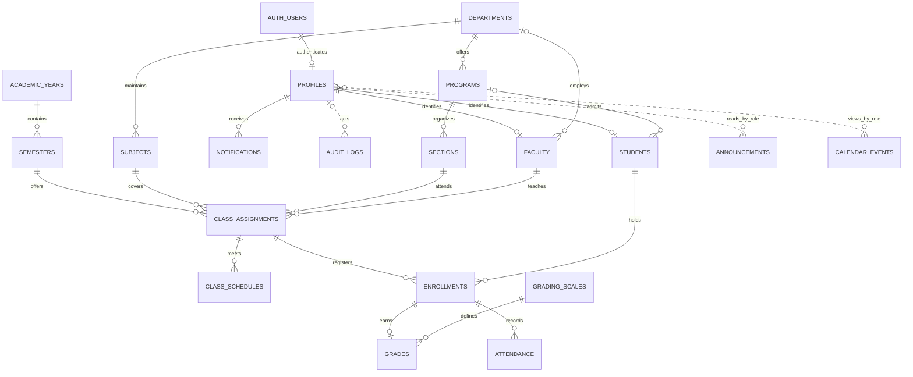

# Database entity relationships

- All application tables have a UUID primary key. Student and faculty primary keys also reference a profile. Administrator identity lives in the profile role.
- A class assignment belongs to a semester, subject, section, and instructor. Unique assignment keys bind enrollment rows to their class subject and term and bind schedule rows to the instructor and section used by conflict constraints.
- A grade is unique per enrollment. Attendance is unique per enrollment and date. Grades reference configurable grading options.
- Dotted announcement, calendar, and audit relationships describe access or retained actor identity. Audience is an optional role enum. A nullable audit actor UUID remains readable after an account is removed by an operator.
- The database implements role and row permissions in [the migrations](../supabase/migrations).
